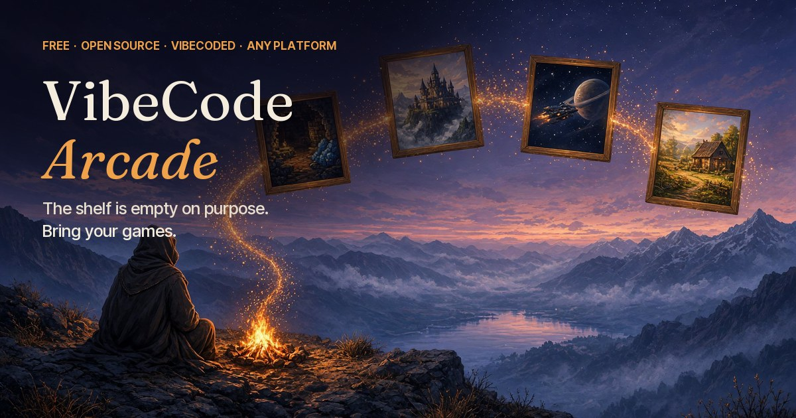

# VibeCode Arcade

**Free. Open source. Vibecoded. Any platform.**

A home for games made by vibecoding, gathered from the whole community and brought to the web, Windows, macOS, Linux, Android, and iOS. Every game is free, every game ships its source, and every game ships the prompt that made it, so the next game can start as a remix.

**The catalog lists one real package: the playable reference cartridge. Community games come next. [Bring yours.](CONTRIBUTING.md)**

[arcade.sockwaffle.com](https://arcade.sockwaffle.com/) · [Submit a game](https://github.com/dirtcodevet/vibecode-arcade/issues/new?template=submit-a-game.yml) · [Discussions](https://github.com/dirtcodevet/vibecode-arcade/discussions) · [The rules](docs/rules.md)

## What's in this repo

Two builds share one repo.

| | What it is | Run it |
| --- | --- | --- |
| **The reveal** (`reveal/`) | The public introduction: a scroll-driven three.js scene. A dreamer by a campfire, embers rising into windows onto game worlds, and a shelf of open slots. | `pnpm --dir reveal install` then `pnpm --dir reveal dev` |
| **The shell** (repo root) | The product: a desktop launcher that admits a game package against open rules, path-jails it, and launches it, with web builds in a sandboxed frame and native builds without a shell. | `pnpm install` then `pnpm dev` |

### The shell

- `pnpm dev` opens the window: **Arcade** (the shelf from `catalog/shelf.json`), **The Deal**, and **Rules**.
- **Rules** runs every admission rule against the reference cartridge in `examples/reference-cartridge`, and **Launch** opens it inside the shell. That cartridge is also the first catalog listing: a real, admitted, playable package. The broken cartridge is a negative fixture and stays off the shelf.
- `pnpm test` runs the rules, path-jail, catalog, and launch-order tests (Node's built-in runner).
- `pnpm validate:catalog` admits `catalog/shelf.json` (and any package folders you pass) against `src/framework/`.
- `pnpm audit:ci` fails on high or critical advisories in the root and reveal lockfiles. CI also runs gitleaks over git history.
- `pnpm smoke` builds the app, admits and launches the reference cartridge, confirms the deliberately broken one is rejected, and saves screenshots to `.work/smoke/`.

The rules live in `src/framework/` with no Electron imports. v0.1 hosts them in Electron; the end-state supervisor is Rust with Tauri as the window. See [docs/platforms.md](docs/platforms.md).

### The reveal

Built with React Three Fiber, drei, and postprocessing, with Lenis smoothing the scroll. The scene is procedural first: sky, mountains, lake, fire, embers, grass, and windows are all code. Painted layers (the valley backdrop, the dreamer, the ledge rock, the window art) drop into slots named in `reveal/assets/slots.json` and replace their procedural stand-ins. If a file is missing, the procedural version stays.

- Painted scene layers: **Grok Imagine** (`reveal/tools/gen_scene.py`)
- Windows onto game worlds and the key art: **Grok Imagine** (`reveal/tools/gen_art.py`)
- Score: **Google Lyria** (`reveal/tools/gen_music.py`), crossfaded into a loop, with procedural Web Audio wind, fire, and chimes on top
- Motion is always on. Add `?motion=reduced` to the URL to hold one still frame with the copy stacked beneath it.

The site lives at [arcade.sockwaffle.com](https://arcade.sockwaffle.com/). Build it with `pnpm --dir reveal build`; the output in `reveal/dist` is a plain static site that any host can serve.

## What's not here

No accounts. No payments. No DRM. No tracking. No affiliate links in Arcade listings. The catalog only lists admitted in-repo packages — never invented games.

## License

MIT. Games on the shelf carry their own free licenses.
